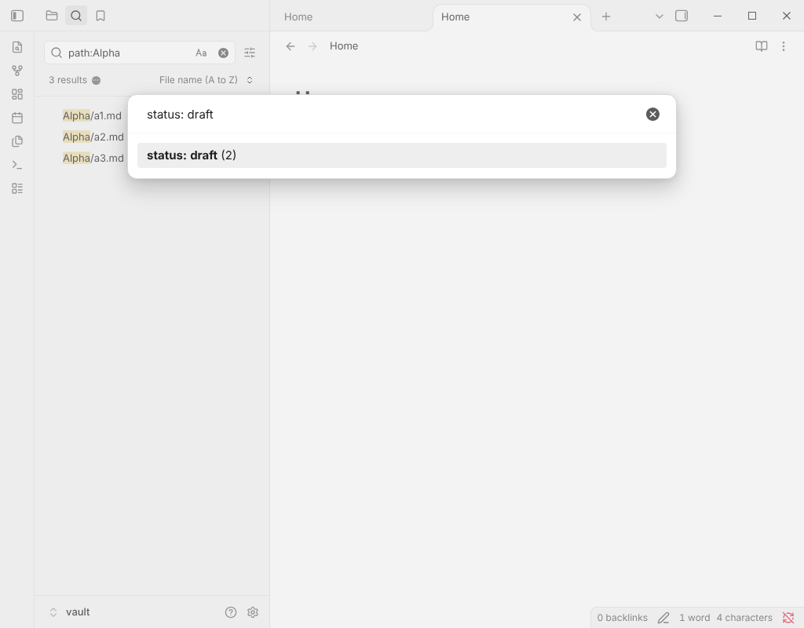

# Random Note Filters

Open or link a random note from a folder, tag, property or the current search results.

The core Random note command draws from the whole vault. This plugin lets you narrow the draw, avoids repeating the notes it picked lately, and keeps private or template notes out of it. It works offline and on mobile.

## Usage

Run these from the command palette (there is no default hotkey: set yours in **Settings → Hotkeys**):

- **Open a random note**: any note in the vault.
- **Open a random note in the current folder**: includes its subfolders (for a note in the vault root, the whole vault).
- **Open a random note sharing a tag with this one**: picks one of the current note's tags, nested tags included.
- **Open a random note from the search results**: run a search in the core Search pane first, then draw from what it lists.
- **Open a random note that nothing links to**: rediscover orphans.
- **Open a random note with a tag...**, **in a folder...** or **with a property value...**: a searchable list with the number of notes in each.
- **Open another random note with the same filter**: roll again without choosing again.
- **Insert a link to a random note** and **... from the search results**: put a link at the cursor, or over the selection, in one undo step.

A draw never returns the note you are on. It also skips the last 20 notes it picked (change it in the settings), so a small set is walked through completely before anything repeats. The list is shared by all the commands.

## Settings

- Open the note in the current tab, a new tab or a split.
- How many recent picks to avoid, or zero to allow repeats.
- Folders and tags to leave out of every draw (nested tags count: `private` also leaves out `private/work`).
- A short notice with the size of the draw, and an optional dice button in the ribbon.

## Notes

- Only Markdown notes are drawn, not images or PDFs.
- The search-results commands read the list shown by the core Search pane through an internal that Obsidian does not document. If a future version of Obsidian removes it, those two commands say so and the rest keep working.
- Nothing leaves your device. The plugin stores your settings and the list of recent picks in its own `data.json`.

## Installation

In Obsidian, open **Settings → Community plugins → Browse** and search for "Random Note Filters".

## More plugins by Siulved54

| Plugin | What it does | Source |
| --- | --- | --- |
| [Shared Blocks](https://obsidian.md/plugins?id=shared-blocks) | Write a block of text once and reuse it in any note. Edit the source and every reference re-renders live. | [shared-blocks](https://github.com/perezamadorluisenrique-gif/shared-blocks) |
| [Text Case and Cleanup](https://obsidian.md/plugins?id=text-format) | Change case, make camelCase or slugs, sort lines and remove duplicates, and repair text pasted out of a PDF, without touching code or URLs. | [text-format](https://github.com/perezamadorluisenrique-gif/text-format) |
| [Typography as You Type](https://obsidian.md/plugins?id=typography-as-you-type) | Curly quotes, dashes and ellipses as you type, kept out of code and maths, with Backspace to take one back. | [smart-typography-plugin](https://github.com/perezamadorluisenrique-gif/smart-typography-plugin) |
| [Section Numbering](https://obsidian.md/plugins?id=section-numbering) | Number headings as an outline (1, 1.1, 1.2) and keep every link to them working when they renumber. | [section-numbering](https://github.com/perezamadorluisenrique-gif/section-numbering) |
| [Spreadsheet to Table](https://obsidian.md/plugins?id=spreadsheet-to-table) | Paste cells from Excel or Google Sheets as a Markdown table with a real header, insert CSV files, and copy tables back out. | [spreadsheet-to-table](https://github.com/perezamadorluisenrique-gif/spreadsheet-to-table) |
| [Hybrid Line Numbers](https://obsidian.md/plugins?id=hybrid-line-numbers) | Relative and hybrid line numbers for Vim-style jumps, where a folded section counts as one line. | [hybrid-line-numbers](https://github.com/perezamadorluisenrique-gif/hybrid-line-numbers) |
| [List Item Callouts](https://obsidian.md/plugins?id=list-item-callouts) | Colour a single list item as a callout by starting it with a character such as `&`, `!` or `?`. | [list-item-callouts](https://github.com/perezamadorluisenrique-gif/list-item-callouts) |
| [Folder Counts](https://obsidian.md/plugins?id=folder-counts) | See how many notes or files each folder holds, right in the file explorer, with a vault total and folder exclusions. | [folder-counts](https://github.com/perezamadorluisenrique-gif/folder-counts) |
| [Note Reading Time](https://obsidian.md/plugins?id=note-reading-time) | Reading time of the current note or your selection in the status bar, optionally saved to a property. | [note-reading-time](https://github.com/perezamadorluisenrique-gif/note-reading-time) |
| [Task Rollover](https://obsidian.md/plugins?id=task-rollover) | Roll unfinished tasks from your last daily note into today's when it is created, with a real undo. | [task-rollover](https://github.com/perezamadorluisenrique-gif/task-rollover) |
| [Zoom Into Section](https://obsidian.md/plugins?id=zoom-into-section) | Zoom into a heading or list item to see only it and its contents, with a breadcrumb bar to climb back out. | [zoom-into-section](https://github.com/perezamadorluisenrique-gif/zoom-into-section) |
| [Link Title on Paste](https://obsidian.md/plugins?id=link-title-on-paste) | Paste a web address and get a Markdown link with the page's title, fetched in the background and undone in one step. | [link-title-on-paste](https://github.com/perezamadorluisenrique-gif/link-title-on-paste) |
| [Update Radar](https://obsidian.md/plugins?id=update-radar) | Checks your installed community plugins for updates in the background, shows what changed, and flags the ones that look abandoned. | [community-update-checker](https://github.com/perezamadorluisenrique-gif/community-update-checker) |
| [Dataview to Bases](https://obsidian.md/plugins?id=dataview-to-bases) | Convert Dataview queries into Bases blocks, and see which queries in your vault can be converted. | [dataview-to-bases](https://github.com/perezamadorluisenrique-gif/dataview-to-bases) |
| [Line Editing Commands](https://obsidian.md/plugins?id=line-editing-commands) | Duplicate, join, sort and reverse lines, insert blank lines and jump to a line number, with multi-cursor support. | [line-editing-commands](https://github.com/perezamadorluisenrique-gif/line-editing-commands) |
| [Note Mover Rules](https://obsidian.md/plugins?id=note-mover-rules) | Move notes into folders by ordered rules on tags, properties, titles and paths, with a preview before any bulk move. | [note-mover-rules](https://github.com/perezamadorluisenrique-gif/note-mover-rules) |
| [Tab History](https://obsidian.md/plugins?id=tab-history) | Keeps each tab's back and forward history across restarts, and adds commands to move, maximize and close tabs. | [tab-history](https://github.com/perezamadorluisenrique-gif/tab-history) |
| [URL Cards](https://obsidian.md/plugins?id=url-cards) | Shows web addresses as cards with title, description and image, and reads existing cardlink blocks. | [url-cards](https://github.com/perezamadorluisenrique-gif/url-cards) |
| [Vim Config](https://obsidian.md/plugins?id=vim-config) | Loads a vimrc-style file from your vault so your key mappings and editor commands are ready when vim mode starts. | [vim-config](https://github.com/perezamadorluisenrique-gif/vim-config) |
| [Task Archive](https://obsidian.md/plugins?id=task-archive) | Moves completed tasks, with their sub-items, into an archive section or note. | [task-archive](https://github.com/perezamadorluisenrique-gif/task-archive) |
| [Revisit Later](https://obsidian.md/plugins?id=revisit-later) | Link the current note into a future daily note, with a date typed in plain English, so it comes back when you want to review it. | [revisit-later](https://github.com/perezamadorluisenrique-gif/revisit-later) |
| [Explorer Colors Plus](https://obsidian.md/plugins?id=explorer-colors-plus) | Color files and folders in the file explorer, with a palette, cascading to children, and import from File Color. | [explorer-colors-plus](https://github.com/perezamadorluisenrique-gif/explorer-colors-plus) |
| [Book Lookup](https://obsidian.md/plugins?id=book-lookup) | Create book notes from Open Library or Google Books, with cover images, ISBN search and Book Search compatible templates. | [book-lookup](https://github.com/perezamadorluisenrique-gif/book-lookup) |
| [Web Search Menu](https://obsidian.md/plugins?id=web-search-menu) | Search the web for selected text or the note title from the right-click menu, with engines you define. | [web-search-menu](https://github.com/perezamadorluisenrique-gif/web-search-menu) |
| [Word Lookup](https://obsidian.md/plugins?id=word-lookup) | Look up any word in a sidebar dictionary with definitions, phonetics, synonyms and antonyms, or create a note for it. | [word-lookup](https://github.com/perezamadorluisenrique-gif/word-lookup) |
| [Quick Translate](https://obsidian.md/plugins?id=quick-translate) | Translate the selection or a whole note into another language with no account, keeping links, code and front matter untouched. | [quick-translate](https://github.com/perezamadorluisenrique-gif/quick-translate) |
| [Dice Rolls](https://obsidian.md/plugins?id=dice-rolls) | Inline dice rolls you click to reroll, in Live Preview and Reading view, with full dice notation, a roll dialog and a roll history. Reads Dice Roller notes. | [dice-rolls](https://github.com/perezamadorluisenrique-gif/dice-rolls) |
| [Claude Studio](https://obsidian.md/plugins?id=claude-studio) | Notion-style AI writing, chat and vault tools powered by your local Claude Code CLI. | [claude-studio](https://github.com/perezamadorluisenrique-gif/claude-studio) |
| [Book Studio](https://obsidian.md/plugins?id=book-studio) | Turn notes into a print-ready paperback PDF and an EPUB 3, entirely on your device. | [book-studio](https://github.com/perezamadorluisenrique-gif/book-studio) |
| [Emoji Search](https://obsidian.md/plugins?id=emoji-search) | Insert emojis from a searchable picker or by typing a :shortcode. | [emoji-search](https://github.com/perezamadorluisenrique-gif/emoji-search) |
| [Inline TOC](https://obsidian.md/plugins?id=inline-toc) | Show a live table of contents inside any note with a toc code block, or insert a plain Markdown one. | [inline-toc](https://github.com/perezamadorluisenrique-gif/inline-toc) |

All of them are in the community directory: Settings -> Community plugins ->
Browse, then search for the name.

Follow new plugins and updates on X: [@luenpereza](https://x.com/luenpereza)
